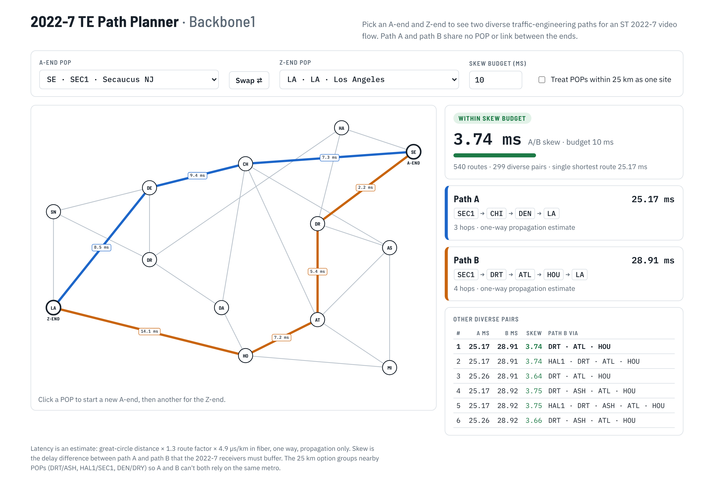

# 2022-7-TE — diverse TE paths for ST 2022-7 video

NetworkX model of the Backbone1 core with a traffic-engineering path planner
for SMPTE ST 2022-7 seamless-protection video. Pick an A-end and Z-end and it
shows two diverse paths, A and B, with their latency and the A/B skew.



*The interactive planner (`te_paths.html`) with SEC1 → LA selected: path A
SEC1–CHI–DEN–LA at 25.17 ms, path B SEC1–DRT–ATL–HOU–LA at 28.91 ms, 3.74 ms
skew.*

## Contents

| File | What it is |
|---|---|
| `te_paths.html` | Interactive A/Z path planner (open in a browser) |
| `te_paths.py` | Path engine and CLI: one A/Z pair as a PNG, or every pair as a CSV |
| `te_paths_template.html` | Page template; `te_paths.py --html` embeds the graph into it |
| `backbone5_model.py` | Backbone1 NetworkX model and map |
| `backbone5_model.png` | Backbone1 map with per-link latency |
| `Backbone-Split5.numbers` | Source data (`BackboneSplit` and `Backbone1` sheets) |
| `output/` | Example PNGs and the all-pairs CSV |
| `images/` | README images |

## TE paths A and B

ST 2022-7 sends the same video stream on two paths and the receiver rebuilds
one clean stream from whichever packets arrive. `te_paths.py` plans those two
legs between any A-end and Z-end POP on Backbone1:

- **Diversity**: path A and path B share no POP and no link between the ends.
  With `--metro-km 25`, POPs within 25 km count as one site (DRT/ASH,
  HAL1/SEC1, DEN/DRY), so A and B can't both rely on the same metro.
- **Skew**: the delay difference between A and B must fit the receivers'
  buffer, set with `--skew-ms` (default 10 ms; set it to your receivers).
- **Choice**: every simple path is enumerated; among disjoint pairs within the
  skew budget it picks the lowest worst-path latency (ties: lower total
  latency, fewer hops, lower skew). If no pair fits the budget it returns the
  lowest-skew pair marked `OVER SKEW BUDGET`, and it reports the fastest
  diverse pair so you can see what the budget costs.

### Interactive planner

Open `te_paths.html` in a browser. Click a POP for the A-end and another for
the Z-end (or use the dropdowns), adjust the skew budget and metro option, and
click any row under *Other diverse pairs* to show it on the map. Its path
engine gives the same answer as `te_paths.py` for all 78 A/Z pairs.

### Command line

```bash
pip install networkx matplotlib numbers-parser
python te_paths.py --a SEC1 --z LA                 # PNG in output/
python te_paths.py --a SE --z LA --skew-ms 5       # 2-letter labels work (DR is ambiguous)
python te_paths.py --a SEC1 --z ASH --metro-km 25  # metro shared-risk on
python te_paths.py --all                           # every A/Z pair -> output/te_paths_all_pairs.csv
python te_paths.py --html te_paths.html            # rebuild the interactive planner
```


### Findings at a 10 ms skew budget

- 77 of 78 A/Z pairs have a diverse pair within budget.
- **LA–SNJ** does not: the best diverse pair is 18.0 / 32.6 ms (14.6 ms skew),
  because the only short route is the direct LA–SNJ link.
- Short direct links force long equal-skew pairs elsewhere: DAL–HOU uses
  21.5 / 29.4 ms rather than the 2.3 ms direct link.

## Backbone1 model

Built from the `BackboneSplit` sheet of `Backbone-Split5.numbers`. Started as
a copy of `network-graphs/backbone5`; the Edge sites and Backbone2 are not
included.


| Element | Style |
|---|---|
| Backbone1 sites (13) | White nodes, dark outline, labelled with the first 2 letters of the POP code |
| Backbone1 links (24) | Straight lines, labelled with estimated one-way latency |

Every run checks that each line clears every node it doesn't terminate on
(`Line visibility: all clear`).

```bash
python backbone5_model.py Backbone-Split5.numbers backbone5_model.png
```

### Latency estimate

```
latency_ms = great_circle_km × 1.3 (route factor) × 4.9 µs/km (fiber) / 1000
```

Fiber propagation only; equipment, queueing and serialization delay are
excluded, so real skew will be somewhat different.

### Editing

- `BACKBONE_POS`: schematic positions of the Backbone1 sites
- `CLOUDS`: optional cloud on-ramps (homing sites, position, coordinates); none are defined
- `node_label()`: node label rule (first 2 letters of the POP code); DRY and DRT both show as DR
- `LABEL_POS`: per-link latency label positions
- `ROUTE_FACTOR`, `FIBER_US_PER_KM`: latency model

### Data handling

- Duplicate rows on the sheet (DRT–HAL1, CHI–ATL) are drawn once.
- The Location cells "SEC1aucus NJ" and "HAL1sey NJ" are read as Secaucus and
  Halsey (Newark).
