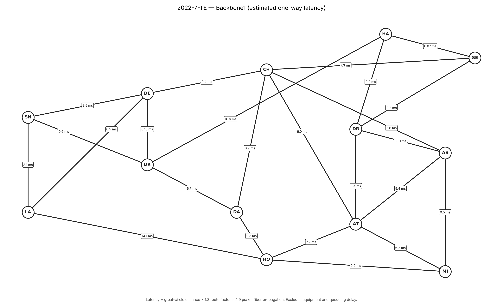

# 2022-7-TE — Backbone1

NetworkX model of the Backbone1 core, built from the `BackboneSplit` sheet of
`Backbone-Split5.numbers`. Started as a copy of `network-graphs/backbone5`; the Edge sites and
Backbone2 are not included.



## What it shows

| Element | Style |
|---|---|
| Backbone1 sites (13) | White nodes, dark outline, unlabelled |
| Backbone1 links (24) | Straight lines, labelled with estimated one-way latency |

Every run checks that each line clears every node it doesn't terminate on
(`Line visibility: all clear`).

## Latency estimate

```
latency_ms = great_circle_km × 1.3 (route factor) × 4.9 µs/km (fiber) / 1000
```

Fiber propagation only; equipment, queueing and serialization delay are
excluded.

## Editing

- `BACKBONE_POS`: schematic positions of the Backbone1 sites
- `CLOUDS`: optional cloud on-ramps (homing sites, position, coordinates); none are defined
- `LABEL_POS`: per-link latency label positions
- `ROUTE_FACTOR`, `FIBER_US_PER_KM`: latency model

## Data handling

- Duplicate rows on the sheet (DRT–HAL1, CHI–ATL) are drawn once.
- The Location cells "SEC1aucus NJ" and "HAL1sey NJ" are read as Secaucus and
  Halsey (Newark).

## Run

```bash
pip install networkx matplotlib numbers-parser
python backbone5_model.py Backbone-Split5.numbers backbone5_model.png
```
