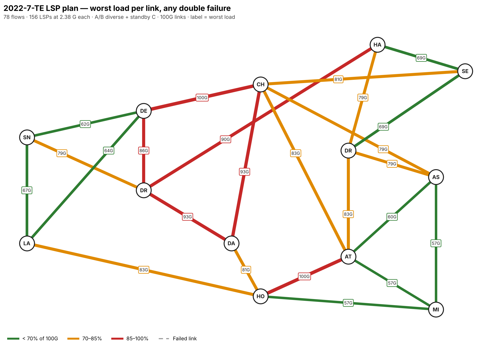
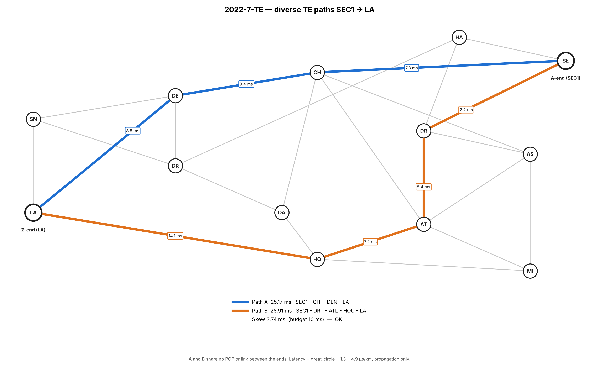
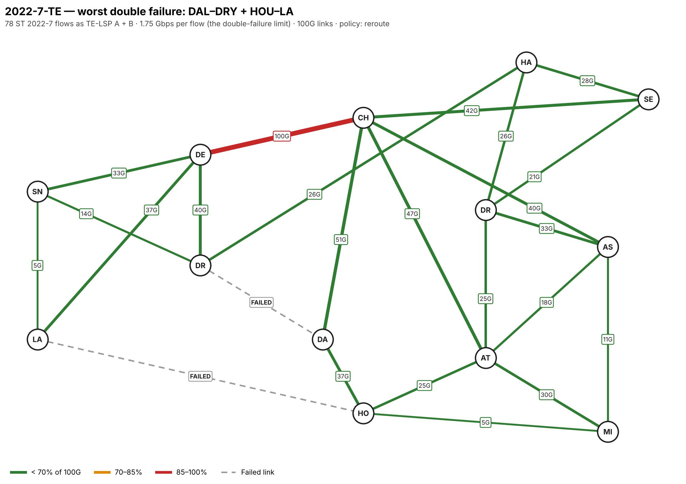
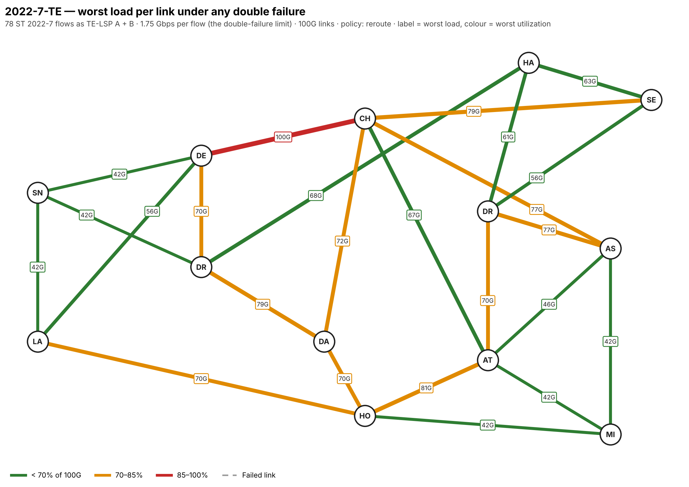

# 2022-7-TE — diverse TE paths for ST 2022-7 video

NetworkX model of the Backbone1 core for SMPTE ST 2022-7 seamless-protection
video over traffic-engineering LSPs:

- **TE-LSP plan**: an optimized A/B LSP design for all 78 POP pairs
  (156 LSPs), diverse end to end, sized to survive any double link failure.
- **Path planner**: pick an A-end and Z-end and see two diverse paths, A and
  B, with their latency and A/B skew.
- **Failure analysis**: how much video the backbone carries before a double
  link failure saturates a 100G link.


## Contents

| File | What it is |
|---|---|
| `te_paths.html` | Interactive A/Z path planner (open in a browser) |
| `te_paths.py` | Path engine and CLI: one A/Z pair as a PNG, or every pair as a CSV |
| `te_failure.py` | Double link failure analysis: highest TE-LSP load with no 100G link saturated |
| `te_paths_template.html` | Page template; `te_paths.py --html` embeds the graph into it |
| `backbone5_model.py` | Backbone1 NetworkX model and map |
| `backbone5_model.png` | Backbone1 map with per-link latency |
| `Backbone-Split5.numbers` | Source data (`BackboneSplit` and `Backbone1` sheets) |
| `lsp_plan.py` | Optimized ST 2022-7 TE-LSP plan for all 78 POP pairs |
| `lsp-plan/` | LSP plan: per-flow table, 156-LSP CSV, optimization summary and risks |
| `failure-report/` | Double link failure report with summary README |
| `output/` | Example TE path PNGs and the all-pairs CSV |
| `images/` | README images |

## TE-LSP plan

Full plan, LSP table and risks: [lsp-plan/](lsp-plan/README.md).
Per-LSP configuration: [`lsp-plan/lsp_plan.csv`](lsp-plan/lsp_plan.csv).

`lsp_plan.py` designs an A and a B LSP for every POP pair (78 flows,
156 LSPs) and checks the design against all 301 normal, single and double
link failure cases.

**Design**
- **Diverse end to end**: A and B share no link, no transit POP and no metro
  site (DRT/ASH, HAL1/SEC1 and DEN/DRY each count as one site).
- **Skew**: A/B delay difference within 10 ms on the primary paths.
- **Standby**: 34 flows get a pre-signalled standby path that shares no link
  with A or B and stays within the skew budget. The other 44 re-signal on the
  shortest path that avoids the other leg's links.
- **LSP settings**: strict explicit routes, link-protect fast reroute,
  setup/hold priority 0/0, 2.38 G reserved per LSP.

**Result**

| Plan | Max video per LSP | Video total | Carried (A + B) |
|---|---:|---:|---:|
| Original (lowest latency, shortest-path reroute, no standby) | 1.75 G | 137 G | 274 G |
| **Optimized LSP plan** | **2.38 G** | **186 G** | **371 G** |

At 2.38 G per LSP no 100G link saturates under any double link failure, a
36% gain. Reserved bandwidth (primaries plus standby) peaks at 79 G.

**Optimization**
1. **Load spread off CHI–DEN**: among diverse pairs within the skew budget
   and at most 3 ms slower than the fastest, the optimizer picked the
   combination with the lowest worst-case link load. 17 of 78 flows moved off
   their lowest-latency pair.
2. **Reroutes stay diverse**: a failed LSP moves to its standby or to a path
   avoiding the other leg, so when failures happen one after another no double
   failure takes out both legs.
3. **Faster recovery**: about half of the both-legs hits now switch to a
   pre-signalled standby instead of waiting for a re-signal.

**Risks**
- **Simultaneous double failures**: one link on A and one on B failing at the
  same moment still drops both legs, for some flow in 197 of 276 double
  failures. Mapping real shared-risk groups (conduits, carriers, buildings)
  is the main fix.
- **Skew after a single failure**: for 40 flows a reroute can push A/B skew
  over 10 ms (worst 33 ms on HAL1–SEC1), leaving the flow unprotected until
  repair. Larger receiver buffers or a non-diverse reroute for metro-adjacent
  pairs would fix it.
- **LA–SNJ** has no diverse pair within 10 ms (14.6 ms skew).
- **No headroom at 2.38 G**: CHI–DEN and ATL–HOU reach 100% in their worst
  double failures, so 2.38 G is the admission limit and these two links are
  the first to upgrade.
- **Model assumptions**: one equal flow per POP pair and estimated latency.
  Re-run with real flow sizes and measured latency before configuring.

```bash
python lsp_plan.py                     # table, CSV, report and maps in lsp-plan/
python lsp_plan.py --slack-ms 5        # trade more latency for more capacity
```



## TE paths A and B

ST 2022-7 sends the same video stream on two paths and the receiver rebuilds
one clean stream from whichever packets arrive. `te_paths.py` plans those two
legs between any A-end and Z-end POP on Backbone1:

- **Diversity**: path A and path B share no POP and no link between the ends.
  With `--metro-km 25`, POPs within 25 km count as one site (DRT/ASH,
  HAL1/SEC1, DEN/DRY), so A and B can't both rely on the same metro.
- **Skew**: the delay difference between A and B must fit the receivers'
  buffer, set with `--skew-ms` (default 10 ms; set it to your receivers).
- **Choice**: every simple path is enumerated; among disjoint pairs within the
  skew budget it picks the lowest worst-path latency (ties: lower total
  latency, fewer hops, lower skew). If no pair fits the budget it returns the
  lowest-skew pair marked `OVER SKEW BUDGET`, and it reports the fastest
  diverse pair so you can see what the budget costs.

### Interactive planner

Open `te_paths.html` in a browser. Click a POP for the A-end and another for
the Z-end (or use the dropdowns), adjust the skew budget and metro option, and
click any row under *Other diverse pairs* to show it on the map. Its path
engine gives the same answer as `te_paths.py` for all 78 A/Z pairs.

### Command line

```bash
pip install networkx matplotlib numpy numbers-parser
python te_paths.py --a SEC1 --z LA                 # PNG in output/
python te_paths.py --a SE --z LA --skew-ms 5       # 2-letter labels work (DR is ambiguous)
python te_paths.py --a SEC1 --z ASH --metro-km 25  # metro shared-risk on
python te_paths.py --all                           # every A/Z pair -> output/te_paths_all_pairs.csv
python te_paths.py --html te_paths.html            # rebuild the interactive planner
```



### Findings at a 10 ms skew budget

- 77 of 78 A/Z pairs have a diverse pair within budget.
- **LA–SNJ** does not: the best diverse pair is 18.0 / 32.6 ms (14.6 ms skew),
  because the only short route is the direct LA–SNJ link.
- Short direct links force long equal-skew pairs elsewhere: DAL–HOU uses
  21.5 / 29.4 ms rather than the 2.3 ms direct link.

## Double link failure analysis

Full write-up: [failure-report/](failure-report/README.md). This analysis
covers the original lowest-latency paths; the optimized plan above raises the
limit from 1.75 G to 2.38 G per LSP.

`te_failure.py` answers: with every link at 100G and all traffic in TE-LSPs,
how much traffic can the network carry with no link saturating under any two
link failures?

- **Traffic**: one ST 2022-7 flow per POP pair (78 flows, equal size), each
  carried as TE-LSP A and TE-LSP B on the diverse paths `te_paths.py` picks.
  Use `--demands file.csv` (columns `A,Z,Gbps`) for a real matrix.
- **Failure behaviour**: an LSP that loses a link re-signals on the
  lowest-latency surviving path (`--policy reroute`, default). With
  `--policy no-reroute` the failed leg stays down and the stream rides the
  other leg.
- **Sweep**: normal, all 24 single failures and all 276 double failures.
  Load is linear in traffic, so the limit is 100G divided by the worst
  per-flow load on any link in any case.

| Condition | Max per flow | Video total | Carried (A + B) | Binding case |
|---|---:|---:|---:|---|
| No failure | 3.23 G | 252 G | 503 G | CHI–DEN |
| Any single failure | 2.27 G | 177 G | 355 G | CHI–DEN with DRY–HAL1 down |
| **Any double failure** | **1.75 G** | **137 G** | **274 G** | CHI–DEN with DAL–DRY + HOU–LA down |

Findings (reroute policy):
- **Keep each flow at or below 1.75 Gbps** (137 G of video, 274 G carried
  with both copies) and no 100G link saturates under any double failure.
  Surviving double failures costs 46% of the no-failure limit.
- **CHI–DEN is the bottleneck.** It carries the most load in normal running
  (54 G at the limit) and is the link that saturates in 8 of the 10 worst
  double failures, because rerouted west–east LSPs converge on it.
- **No double failure splits the network** (edge connectivity 3), but in 174
  of 276 double failures at least one flow loses both A and B at once, a hit
  until the LSPs re-signal. No single failure hits both legs of any flow.
- With `--policy no-reroute` failures only remove load, so the limit is the
  no-failure 3.23 G per flow, at the cost of running unprotected on one leg.

Reroute ignores bandwidth (no CSPF reservation), so this is the load the
network would see if every LSP took its shortest surviving path.

```bash
python te_failure.py                       # report, cases CSV and maps in failure-report/
python te_failure.py --policy no-reroute
```





## Backbone1 model

Built from the `BackboneSplit` sheet of `Backbone-Split5.numbers`. Started as
a copy of `network-graphs/backbone5`; the Edge sites and Backbone2 are not
included.


| Element | Style |
|---|---|
| Backbone1 sites (13) | White nodes, dark outline, labelled with the first 2 letters of the POP code |
| Backbone1 links (24) | Straight lines, labelled with estimated one-way latency |

Every run checks that each line clears every node it doesn't terminate on
(`Line visibility: all clear`).

```bash
python backbone5_model.py Backbone-Split5.numbers backbone5_model.png
```

### Latency estimate

```
latency_ms = great_circle_km × 1.3 (route factor) × 4.9 µs/km (fiber) / 1000
```

Fiber propagation only; equipment, queueing and serialization delay are
excluded, so real skew will be somewhat different.

### Editing

- `BACKBONE_POS`: schematic positions of the Backbone1 sites
- `CLOUDS`: optional cloud on-ramps (homing sites, position, coordinates); none are defined
- `node_label()`: node label rule (first 2 letters of the POP code); DRY and DRT both show as DR
- `LABEL_POS`: per-link latency label positions
- `ROUTE_FACTOR`, `FIBER_US_PER_KM`: latency model

### Data handling

- Duplicate rows on the sheet (DRT–HAL1, CHI–ATL) are drawn once.
- The Location cells "SEC1aucus NJ" and "HAL1sey NJ" are read as Secaucus and
  Halsey (Newark).
