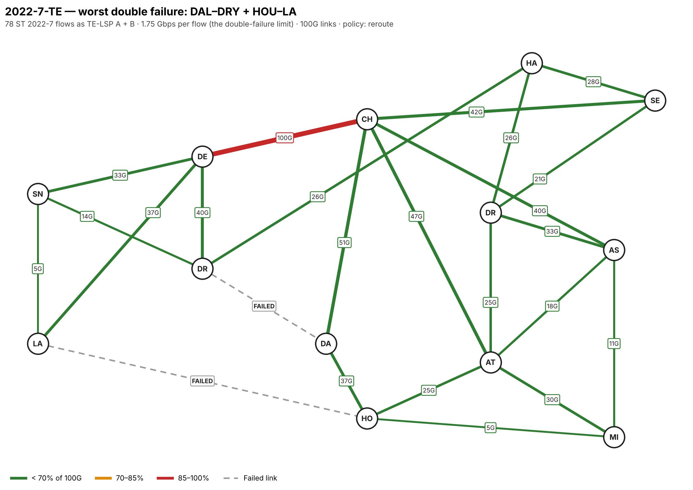
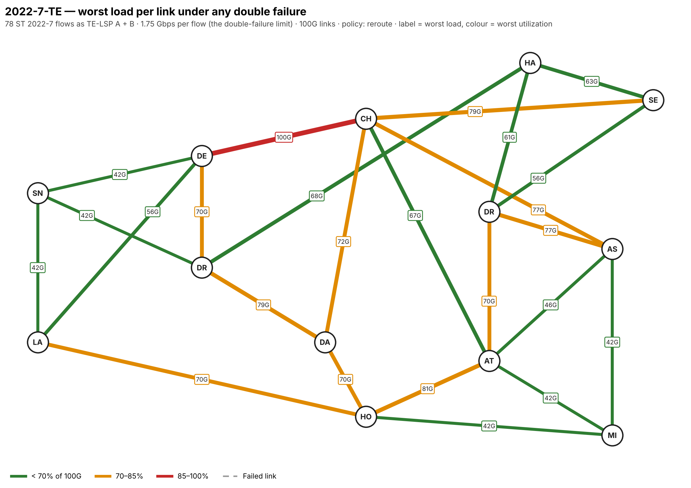
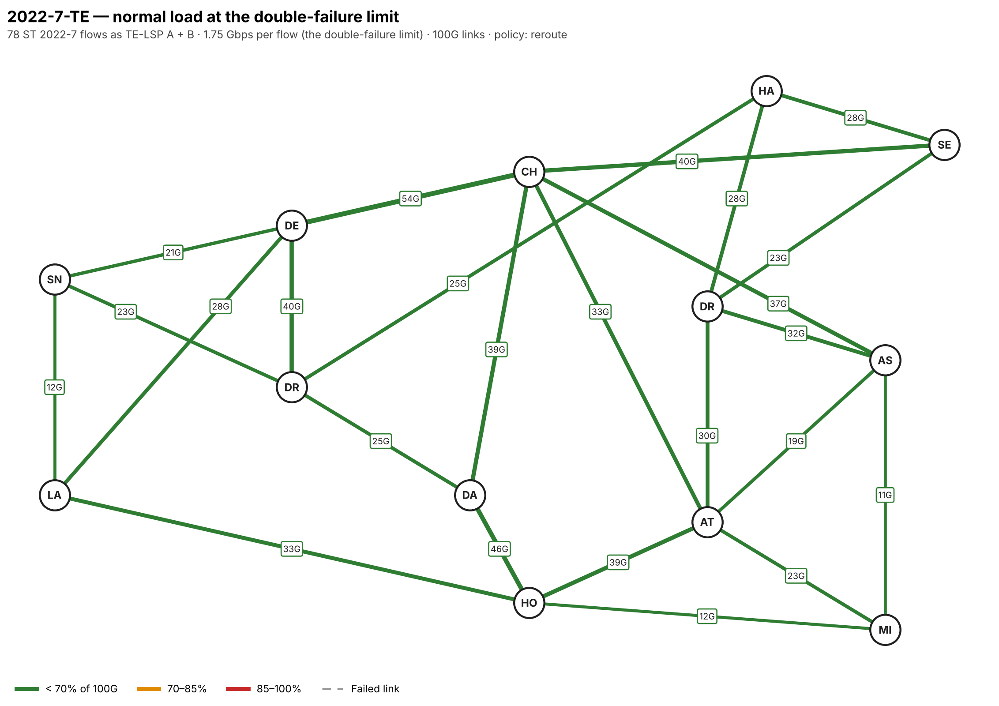

# Double link failure report — Backbone1, ST 2022-7 TE-LSPs

**Question:** if every Backbone1 link is 100G and all traffic rides
traffic-engineering LSPs, what is the highest load the network can carry
without any link saturating when any two links fail at once?

**Answer:** **1.75 Gbps per 2022-7 flow**, which is **137 G of video**
across the network, or **274 G on the backbone** counting both the A and B
copies. Above that, at least one double failure pushes a link past 100G.



## Headline numbers

| Condition | Max per flow | Video total | Carried (A + B) | Binding link | Failure that binds |
|---|---:|---:|---:|---|---|
| No failure | 3.23 G | 252 G | 503 G | CHI–DEN | none |
| Any single failure | 2.27 G | 177 G | 355 G | CHI–DEN | DRY–HAL1 |
| **Any double failure** | **1.75 G** | **137 G** | **274 G** | **CHI–DEN** | **DAL–DRY + HOU–LA** |

Surviving any double failure costs **46%** of the no-failure limit.

## Key findings

1. **CHI–DEN is the bottleneck.** It is the busiest link in normal running
   (54 G at the 1.75 G limit) and the link that saturates in 8 of the 10
   worst double failures. When southern or western links fail, rerouted
   west–east LSPs converge on it. Adding capacity on CHI–DEN, or a second
   west–east route that avoids it, raises the limit for the whole network.
2. **ATL–HOU is next.** With CHI–DAL and CHI–DEN both down it reaches 81 G
   at the limit, the worst case that doesn't involve CHI–DEN as the hot link.
3. **No double failure splits the network.** Every POP has at least three
   links (edge connectivity 3), so all POPs stay reachable.
4. **Single failures are hitless.** A and B are link-disjoint, so no single
   failure takes out both legs of any flow.
5. **Most double failures cause a brief hit to some flows.** In 174 of the
   276 double failures, at least one flow loses both A and B at once and
   drops until its LSPs re-signal. The worst cases hit 10–12 flows:

   | Double failure | Flows losing both legs |
   |---|---:|
   | CHI–DEN + DRY–HAL1 | 12 |
   | ATL–HOU + CHI–DAL | 11 |
   | CHI–DEN + HOU–LA | 11 |
   | ATL–DRT + CHI–SEC1 | 10 |
   | DEN–LA + HOU–LA | 10 |

6. **Not rerouting avoids the load problem but leaves flows unprotected.**
   If failed LSPs stay down, failures only remove load and the limit stays
   at the no-failure 3.23 G per flow. Affected flows then run on one leg
   until repair, and the flows above stay down for the whole failure.

## Worst double failures

At 1.75 G per flow:

| Double failure | Hottest link | Load | LSPs rerouted |
|---|---|---:|---:|
| DAL–DRY + HOU–LA | CHI–DEN | 100.0 G | 31 |
| ATL–HOU + DRY–HAL1 | CHI–DEN | 91.2 G | 36 |
| DAL–DRY + DRY–HAL1 | CHI–DEN | 89.5 G | 28 |
| DRY–HAL1 + HOU–LA | CHI–DEN | 89.5 G | 33 |
| DAL–HOU + HOU–LA | CHI–DEN | 86.0 G | 39 |
| CHI–DAL + CHI–DEN | ATL–HOU | 80.7 G | 49 |

## Worst load on each link

Each link's highest load at 1.75 G per flow over all 301 cases (normal, 24
single and 276 double failures):



| Link | Normal | Worst | Worst when down |
|---|---:|---:|---|
| CHI–DEN | 54.4 G | 100.0 G | DAL–DRY + HOU–LA |
| ATL–HOU | 38.6 G | 80.7 G | CHI–DAL + CHI–DEN |
| DAL–DRY | 24.6 G | 78.9 G | CHI–DEN + DRY–HAL1 |
| CHI–SEC1 | 40.4 G | 78.9 G | ASH–DRT + ATL–DRT |
| ASH–CHI | 36.8 G | 77.2 G | CHI–SEC1 + DRY–HAL1 |
| ASH–DRT | 31.6 G | 77.2 G | ATL–DRT + CHI–SEC1 |
| CHI–DAL | 38.6 G | 71.9 G | CHI–DEN + DRY–HAL1 |

The full table for all 24 links is in [`failure_report.txt`](failure_report.txt).

Normal running at the same load, for comparison:



## Method and assumptions

- **Traffic:** one ST 2022-7 flow between every pair of POPs (78 flows,
  equal size). There is no measured traffic matrix yet; the result scales
  with a real one through `--demands`.
- **LSPs:** each flow is TE-LSP A plus TE-LSP B, each carrying the full flow,
  on the diverse paths from `te_paths.py` (no shared POP or link, 10 ms skew
  budget).
- **Failure behaviour:** an LSP that loses a link re-signals on the
  lowest-latency surviving path. This ignores bandwidth (no CSPF bandwidth
  reservation), so it shows the load the network would see if every LSP
  took its shortest surviving path.
- **Sweep:** normal, all 24 single and all 276 double link failures. Load
  grows linearly with traffic, so the limit is 100G divided by the worst
  per-flow load on any link in any case.
- **Links:** all 24 Backbone1 links at 100G; latency is the model's
  propagation estimate.

## Files

| File | Contents |
|---|---|
| [`failure_report.txt`](failure_report.txt) | Full report, reroute policy |
| [`failure_cases.csv`](failure_cases.csv) | All 301 cases: failed links, hottest link, load, LSPs rerouted, flows hit |
| `failure_worst_double.png` | Map of the binding double failure |
| `failure_worst_per_link.png` | Map of each link's worst load |
| `failure_normal.png` | Map of normal load at the limit |
| `*_noreroute.*` | Same outputs with failed LSPs left down |

## Rerun

From `2022-7-TE/`:

```bash
pip install networkx matplotlib numbers-parser
python te_failure.py                        # reroute policy (default)
python te_failure.py --policy no-reroute
python te_failure.py --demands my.csv       # columns A,Z,Gbps; answer is a multiple of the matrix
```

Outputs are written to this folder.
