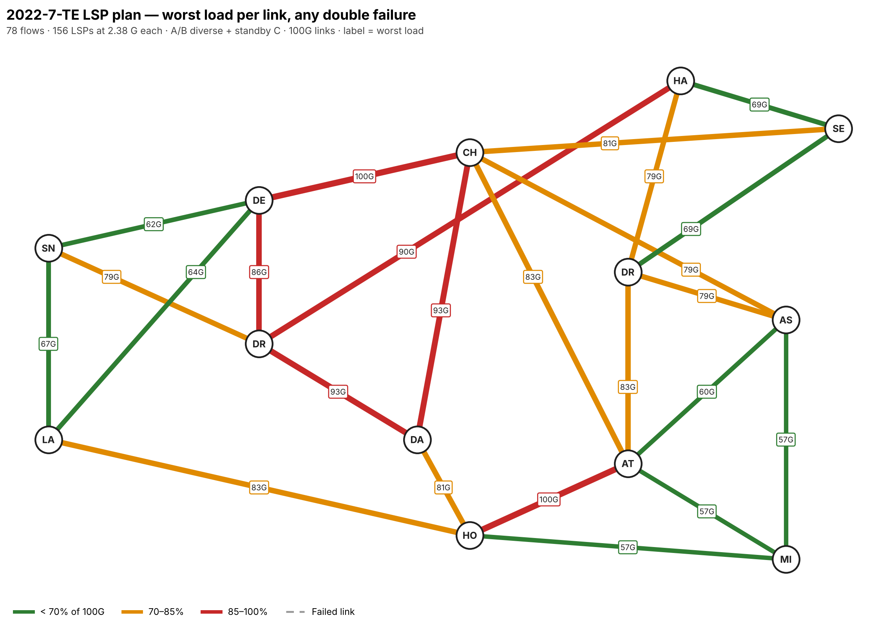

# 2022-7 TE-LSP plan — Backbone1

A traffic-engineering LSP design for ST 2022-7 video between every pair of
Backbone1 POPs: **78 flows, 156 LSPs** (an A and a B LSP per flow).
`lsp_plan.py` builds it, checks it against every normal, single and double
link failure, and writes the tables, report and maps in this folder.

## Design rules

| Item | Setting |
|---|---|
| LSPs per flow | 2: `V27-<head>-<tail>-A` and `-B`, both carrying the full video flow |
| A/B diversity | Primary paths share **no link and no transit POP** from source to destination |
| Metro shared risk | Transit POPs within 25 km count as one site (DRT/ASH, HAL1/SEC1, DEN/DRY), so A and B never both rely on the same metro |
| Skew | A/B delay difference within **10 ms** on the primaries (set to your receivers' buffer) |
| Path selection | Strict explicit route (ERO) per LSP, as in the tables below |
| Standby (34 flows) | Pre-signalled secondary path C, shared by A and B: no link in common with A or B and within the skew budget of both |
| Dynamic reroute (44 flows) | No standby fits the skew budget, so a failed LSP re-signals by CSPF on the shortest path that **excludes the other leg's links** |
| Fast reroute | Link-protect bypass on every LSP, to cover the gap until the head-end moves the LSP |
| Bandwidth | **2.38 G** reserved per LSP (the design limit, see below) |
| Priority | Setup/hold 0/0, so video LSPs are never preempted |

## Result

| Plan | Max video per LSP | Video total | Carried (A + B) | Binding case |
|---|---:|---:|---:|---|
| Original (lowest latency, shortest-path reroute, no standby) | 1.75 G | 137 G | 274 G | CHI–DEN with DAL–DRY + HOU–LA down |
| New rules, lowest-latency paths | 2.22 G | 173 G | 346 G | |
| **New plan, load-optimized** | **2.38 G** | **186 G** | **371 G** | CHI–DEN with CHI–DAL + HOU–LA down, and ATL–HOU with CHI–DEN + DRY–HAL1 down |

At 2.38 G per LSP no 100G link saturates under any double link failure, a
**36% gain** over the original plan. Reserved bandwidth (primaries plus the
shared standby) peaks at 79 G on CHI–DEN, so every LSP and standby can be
signalled with its full bandwidth.



## Optimization summary

1. **Diversity tightened.** A and B now avoid each other's links, transit POPs
   and metro sites end to end. The original plan avoided shared links and
   POPs but could put A through DRT and B through ASH, on the same campus.
2. **Load spread off CHI–DEN.** For each flow the optimizer kept the diverse
   A/B pairs within the skew budget whose slower path is no more than 3 ms
   behind the fastest option, then searched across all flows to minimize the
   worst link load over all 301 failure cases. 17 of 78 flows moved off their
   lowest-latency pair. Worst-case load is now spread across CHI–DEN, ATL–HOU,
   CHI–DAL and DAL–DRY instead of piling onto CHI–DEN.
3. **Reroutes stay diverse.** A failed LSP moves to its standby or to a path
   that avoids the other leg, so after the first failure A and B are still
   apart. With failures that happen one after another (time to re-signal in
   between), no double failure takes out both legs.
4. **Faster recovery.** In the original plan every both-legs hit waited for a
   CSPF re-signal (518 flow events across 174 double failures). Now 277 of
   548 flow events switch to a pre-signalled standby, and 271 wait for a
   re-signal.

## Risks

| Risk | Detail | Mitigation |
|---|---|---|
| Simultaneous double failure | If one link on A and one on B fail at the same moment, both legs drop. This hits some flow in 197 of 276 double failures, slightly more than the original 174 because diverse paths are longer. | Map real shared-risk groups (conduits, carriers, buildings) so the most likely double failures can't hit A and B. Give critical flows a third live copy. |
| Skew after a single failure | 44 flows have no standby within 10 ms. Their diverse reroute can run long: 119 single-failure cases across 40 flows go over 10 ms, worst 33.3 ms (HAL1–SEC1 with DRT–HAL1 down). Until the leg is repaired, the receiver can't merge A and B and the flow runs unprotected. | Size receiver buffers for the worst reroute skew, or allow a non-diverse reroute for metro-adjacent pairs (HAL1–SEC1, ASH–DRT, DEN–DRY, ASH–HAL1, DRT–HAL1). |
| LA–SNJ | No diverse pair fits 10 ms; the best is 18.0 / 32.6 ms (14.6 ms skew). | Larger receiver buffer for this flow, or a new route between LA and SNJ. |
| Capacity headroom | At 2.38 G per LSP, CHI–DEN and ATL–HOU reach 100% in their worst double failures. Any growth beyond 2.38 G per flow, or unequal flow sizes, breaks the double-failure guarantee. | Use 2.38 G as the admission limit. Re-run with a real demand matrix. Add capacity on CHI–DEN and ATL–HOU first. |
| Standby shares a POP | 11 flows' standby path transits a POP that A or B also uses (no fully POP-diverse standby exists within skew). | A failure of that POP can hit two of the three paths. |
| End POPs | A and B start and end on the same head-end and tail-end POPs. A POP failure takes the flow down regardless of the LSP design. | Dual-home sources and receivers to two POPs where it matters. |
| Model assumptions | One equal flow per POP pair; latency is a propagation estimate; all links 100G. | Re-run `lsp_plan.py` with measured latency and real flow sizes before configuring. |

## LSP table

One row per flow. A is the faster primary; B is the diverse primary; C is the
shared standby (blank = dynamic diverse reroute). ⚠ marks a flow over the
10 ms skew budget. "Re-pathed" marks flows the optimizer moved off the
lowest-latency pair. Per-LSP configuration (156 rows, with bandwidth,
priority, FRR and diversity constraint) is in [`lsp_plan.csv`](lsp_plan.csv).

| # | Flow | Path A (primary) | A ms | Path B (primary) | B ms | Skew ms | Standby C | C ms | Re-pathed |
|---:|---|---|---:|---|---:|---:|---|---:|:---:|
| 1 | ASH–ATL | ASH - ATL | 5.43 | ASH - DRT - ATL | 5.45 | 0.01 | ASH - CHI - ATL | 11.85 |  |
| 2 | ASH–CHI | ASH - CHI | 5.82 | ASH - ATL - CHI | 11.47 | 5.65 | ASH - DRT - SEC1 - CHI | 9.50 | ✓ |
| 3 | ASH–DAL | ASH - ATL - HOU - DAL | 14.92 | ASH - DRT - SEC1 - CHI - DAL | 17.75 | 2.83 | ASH - CHI - DEN - DRY - DAL | 22.03 | ✓ |
| 4 | ASH–DEN | ASH - CHI - DEN | 15.23 | ASH - DRT - HAL1 - DRY - DEN | 18.86 | 3.63 | dynamic, diverse from other leg |  |  |
| 5 | ASH–DRT | ASH - ATL - DRT | 10.87 | ASH - CHI - SEC1 - DRT | 15.30 | 4.44 | dynamic, diverse from other leg |  |  |
| 6 | ASH–DRY | ASH - DRT - HAL1 - DRY | 18.73 | ASH - CHI - DAL - DRY | 20.73 | 2.01 | ASH - ATL - CHI - DEN - DRY | 21.01 | ✓ |
| 7 | ASH–HAL1 | ASH - ATL - DRT - HAL1 | 13.03 | ASH - CHI - SEC1 - HAL1 | 13.14 | 0.12 | dynamic, diverse from other leg |  |  |
| 8 | ASH–HOU | ASH - ATL - HOU | 12.62 | ASH - CHI - DAL - HOU | 16.37 | 3.75 | ASH - MIA - HOU | 19.46 |  |
| 9 | ASH–LA | ASH - ATL - HOU - LA | 26.67 | ASH - CHI - DAL - DRY - DEN - LA | 29.37 | 2.70 | ASH - DRT - HAL1 - DRY - SNJ - LA | 31.42 | ✓ |
| 10 | ASH–MIA | ASH - MIA | 9.54 | ASH - ATL - MIA | 11.65 | 2.10 | dynamic, diverse from other leg |  |  |
| 11 | ASH–SEC1 | ASH - CHI - SEC1 | 13.07 | ASH - ATL - DRT - SEC1 | 13.10 | 0.03 | dynamic, diverse from other leg |  |  |
| 12 | ASH–SNJ | ASH - DRT - HAL1 - DRY - DEN - SNJ | 28.36 | ASH - ATL - HOU - LA - SNJ | 29.80 | 1.45 | ASH - CHI - DAL - DRY - SNJ | 30.29 | ✓ |
| 13 | ATL–CHI | ATL - CHI | 6.04 | ATL - ASH - CHI | 11.25 | 5.22 | ATL - DRT - SEC1 - CHI | 14.92 |  |
| 14 | ATL–DAL | ATL - HOU - DAL | 9.49 | ATL - CHI - DAL | 14.28 | 4.79 | dynamic, diverse from other leg |  |  |
| 15 | ATL–DEN | ATL - CHI - DEN | 15.45 | ATL - HOU - DAL - DRY - DEN | 16.29 | 0.84 | dynamic, diverse from other leg |  |  |
| 16 | ATL–DRT | ATL - DRT | 5.43 | ATL - ASH - DRT | 5.45 | 0.01 | dynamic, diverse from other leg |  |  |
| 17 | ATL–DRY | ATL - CHI - DEN - DRY | 15.58 | ATL - HOU - DAL - DRY | 16.16 | 0.58 | ATL - DRT - HAL1 - DRY | 24.15 |  |
| 18 | ATL–HAL1 | ATL - DRT - HAL1 | 7.59 | ATL - CHI - SEC1 - HAL1 | 13.36 | 5.77 | dynamic, diverse from other leg |  |  |
| 19 | ATL–HOU | ATL - HOU | 7.19 | ATL - MIA - HOU | 16.13 | 8.95 | ATL - CHI - DAL - HOU | 16.59 |  |
| 20 | ATL–LA | ATL - HOU - LA | 21.24 | ATL - CHI - DEN - LA | 23.96 | 2.71 | dynamic, diverse from other leg |  |  |
| 21 | ATL–MIA | ATL - MIA | 6.22 | ATL - ASH - MIA | 14.98 | 8.76 | dynamic, diverse from other leg |  |  |
| 22 | ATL–SEC1 | ATL - DRT - SEC1 | 7.67 | ATL - CHI - SEC1 | 13.29 | 5.62 | ATL - ASH - DRT - HAL1 - SEC1 | 7.68 |  |
| 23 | ATL–SNJ | ATL - HOU - LA - SNJ | 24.37 | ATL - CHI - DEN - SNJ | 24.95 | 0.58 | ATL - DRT - HAL1 - DRY - SNJ | 33.70 |  |
| 24 | CHI–DAL | CHI - DAL | 8.25 | CHI - ATL - HOU - DAL | 15.53 | 7.28 | CHI - DEN - DRY - DAL | 16.21 |  |
| 25 | CHI–DEN | CHI - DEN | 9.41 | CHI - DAL - DRY - DEN | 15.05 | 5.63 | dynamic, diverse from other leg |  |  |
| 26 | CHI–DRT | CHI - SEC1 - DRT | 9.49 | CHI - ATL - DRT | 11.47 | 1.98 | CHI - ASH - DRT | 5.83 | ✓ |
| 27 | CHI–DRY | CHI - DEN - DRY | 9.54 | CHI - DAL - DRY | 14.92 | 5.37 | dynamic, diverse from other leg |  |  |
| 28 | CHI–HAL1 | CHI - SEC1 - HAL1 | 7.33 | CHI - ASH - DRT - HAL1 | 7.99 | 0.67 | dynamic, diverse from other leg |  |  |
| 29 | CHI–HOU | CHI - DAL - HOU | 10.55 | CHI - ATL - HOU | 13.22 | 2.67 | dynamic, diverse from other leg |  |  |
| 30 | CHI–LA | CHI - DEN - LA | 17.92 | CHI - DAL - HOU - LA | 24.61 | 6.69 | dynamic, diverse from other leg |  |  |
| 31 | CHI–MIA | CHI - ATL - MIA | 12.25 | CHI - ASH - MIA | 15.36 | 3.11 | CHI - DAL - HOU - MIA | 20.47 |  |
| 32 | CHI–SEC1 | CHI - SEC1 | 7.25 | CHI - ASH - DRT - SEC1 | 8.07 | 0.81 | CHI - ATL - DRT - HAL1 - SEC1 | 13.70 |  |
| 33 | CHI–SNJ | CHI - DEN - SNJ | 18.91 | CHI - DAL - HOU - LA - SNJ | 27.74 | 8.83 | dynamic, diverse from other leg |  |  |
| 34 | DAL–DEN | DAL - CHI - DEN | 17.66 | DAL - DRY - SNJ - DEN | 25.72 | 8.06 | DAL - HOU - LA - DEN | 24.87 | ✓ |
| 35 | DAL–DRT | DAL - CHI - ASH - DRT | 14.08 | DAL - HOU - ATL - DRT | 14.92 | 0.84 | dynamic, diverse from other leg |  |  |
| 36 | DAL–DRY | DAL - HOU - LA - SNJ - DRY | 29.05 | DAL - CHI - SEC1 - HAL1 - DRY | 32.13 | 3.08 | dynamic, diverse from other leg |  | ✓ |
| 37 | DAL–HAL1 | DAL - CHI - SEC1 - HAL1 | 15.57 | DAL - HOU - ATL - DRT - HAL1 | 17.09 | 1.51 | DAL - DRY - HAL1 | 23.22 |  |
| 38 | DAL–HOU | DAL - CHI - ATL - HOU | 21.47 | DAL - DRY - DEN - LA - HOU | 29.36 | 7.89 | dynamic, diverse from other leg |  |  |
| 39 | DAL–LA | DAL - HOU - LA | 16.36 | DAL - DRY - SNJ - LA | 19.35 | 3.00 | DAL - CHI - DEN - LA | 26.17 | ✓ |
| 40 | DAL–MIA | DAL - HOU - MIA | 12.22 | DAL - CHI - ATL - MIA | 20.50 | 8.28 | dynamic, diverse from other leg |  |  |
| 41 | DAL–SEC1 | DAL - CHI - SEC1 | 15.50 | DAL - HOU - ATL - DRT - SEC1 | 17.16 | 1.66 | DAL - DRY - HAL1 - SEC1 | 23.29 |  |
| 42 | DAL–SNJ | DAL - DRY - SNJ | 16.22 | DAL - HOU - LA - SNJ | 19.49 | 3.27 | dynamic, diverse from other leg |  |  |
| 43 | DEN–DRT | DEN - DRY - HAL1 - DRT | 18.85 | DEN - CHI - ATL - DRT | 20.88 | 2.04 | dynamic, diverse from other leg |  | ✓ |
| 44 | DEN–DRY | DEN - SNJ - DRY | 19.05 | DEN - CHI - DAL - DRY | 24.33 | 5.27 | dynamic, diverse from other leg |  |  |
| 45 | DEN–HAL1 | DEN - DRY - HAL1 | 16.68 | DEN - CHI - SEC1 - HAL1 | 16.74 | 0.05 | dynamic, diverse from other leg |  |  |
| 46 | DEN–HOU | DEN - LA - HOU | 22.56 | DEN - CHI - ATL - HOU | 22.64 | 0.07 | DEN - SNJ - DRY - DAL - HOU | 28.03 | ✓ |
| 47 | DEN–LA | DEN - LA | 8.51 | DEN - SNJ - LA | 12.63 | 4.12 | dynamic, diverse from other leg |  |  |
| 48 | DEN–MIA | DEN - DRY - DAL - HOU - MIA | 19.02 | DEN - CHI - ATL - MIA | 21.66 | 2.65 | dynamic, diverse from other leg |  |  |
| 49 | DEN–SEC1 | DEN - CHI - SEC1 | 16.67 | DEN - DRY - HAL1 - SEC1 | 16.76 | 0.09 | dynamic, diverse from other leg |  |  |
| 50 | DEN–SNJ | DEN - SNJ | 9.50 | DEN - LA - SNJ | 11.64 | 2.14 | DEN - DRY - SNJ | 9.69 | ✓ |
| 51 | DRT–DRY | DRT - SEC1 - HAL1 - DRY | 18.86 | DRT - ASH - CHI - DAL - DRY | 20.75 | 1.89 | DRT - ATL - CHI - DEN - DRY | 21.01 | ✓ |
| 52 | DRT–HAL1 | DRT - HAL1 | 2.16 | DRT - SEC1 - HAL1 | 2.31 | 0.15 | dynamic, diverse from other leg |  |  |
| 53 | DRT–HOU | DRT - ATL - HOU | 12.62 | DRT - ASH - CHI - DAL - HOU | 16.39 | 3.77 | dynamic, diverse from other leg |  |  |
| 54 | DRT–LA | DRT - ATL - HOU - LA | 26.67 | DRT - HAL1 - DRY - DEN - LA | 27.35 | 0.68 | DRT - ASH - CHI - DEN - SNJ - LA | 27.88 | ✓ |
| 55 | DRT–MIA | DRT - ASH - MIA | 9.56 | DRT - ATL - MIA | 11.65 | 2.09 | dynamic, diverse from other leg |  |  |
| 56 | DRT–SEC1 | DRT - SEC1 | 2.23 | DRT - HAL1 - SEC1 | 2.23 | 0.00 | dynamic, diverse from other leg |  |  |
| 57 | DRT–SNJ | DRT - HAL1 - DRY - SNJ | 28.27 | DRT - ATL - HOU - LA - SNJ | 29.81 | 1.53 | DRT - ASH - CHI - DEN - SNJ | 24.74 | ✓ |
| 58 | DRY–HAL1 | DRY - HAL1 | 16.55 | DRY - DEN - CHI - SEC1 - HAL1 | 16.87 | 0.32 | DRY - DAL - HOU - ATL - DRT - HAL1 | 23.75 |  |
| 59 | DRY–HOU | DRY - SNJ - LA - HOU | 26.74 | DRY - DEN - CHI - ASH - ATL - HOU | 27.98 | 1.24 | DRY - HAL1 - SEC1 - CHI - DAL - HOU | 34.43 | ✓ |
| 60 | DRY–LA | DRY - DEN - LA | 8.64 | DRY - SNJ - LA | 12.69 | 4.05 | dynamic, diverse from other leg |  |  |
| 61 | DRY–MIA | DRY - DAL - HOU - MIA | 18.89 | DRY - DEN - CHI - ATL - MIA | 21.80 | 2.91 | DRY - HAL1 - DRT - ASH - MIA | 28.27 |  |
| 62 | DRY–SEC1 | DRY - HAL1 - SEC1 | 16.63 | DRY - DEN - CHI - SEC1 | 16.80 | 0.17 | DRY - DAL - HOU - ATL - DRT - SEC1 | 23.83 |  |
| 63 | DRY–SNJ | DRY - SNJ | 9.56 | DRY - DEN - SNJ | 9.63 | 0.07 | dynamic, diverse from other leg |  |  |
| 64 | HAL1–HOU | HAL1 - DRT - ATL - HOU | 14.78 | HAL1 - SEC1 - CHI - DAL - HOU | 17.88 | 3.10 | dynamic, diverse from other leg |  |  |
| 65 | HAL1–LA | HAL1 - DRY - DEN - LA | 25.19 | HAL1 - DRT - ATL - HOU - LA | 28.84 | 3.64 | HAL1 - SEC1 - CHI - DEN - SNJ - LA | 29.37 |  |
| 66 | HAL1–MIA | HAL1 - DRT - ASH - MIA | 11.72 | HAL1 - SEC1 - CHI - ATL - MIA | 19.58 | 7.86 | dynamic, diverse from other leg |  |  |
| 67 | HAL1–SEC1 | HAL1 - SEC1 | 0.07 | HAL1 - DRT - SEC1 | 4.40 | 4.32 | dynamic, diverse from other leg |  |  |
| 68 | HAL1–SNJ | HAL1 - DRY - SNJ | 26.11 | HAL1 - DRT - ATL - HOU - LA - SNJ | 31.97 | 5.86 | HAL1 - SEC1 - CHI - DEN - SNJ | 26.24 |  |
| 69 | HOU–LA | HOU - LA | 14.05 | HOU - DAL - DRY - DEN - LA | 17.61 | 3.56 | dynamic, diverse from other leg |  |  |
| 70 | HOU–MIA | HOU - MIA | 9.92 | HOU - ATL - MIA | 13.40 | 3.49 | dynamic, diverse from other leg |  |  |
| 71 | HOU–SEC1 | HOU - ATL - DRT - SEC1 | 14.85 | HOU - DAL - CHI - SEC1 | 17.81 | 2.95 | HOU - MIA - ASH - DRT - HAL1 - SEC1 | 21.71 |  |
| 72 | HOU–SNJ | HOU - LA - SNJ | 17.19 | HOU - DAL - DRY - SNJ | 18.53 | 1.34 | dynamic, diverse from other leg |  |  |
| 73 | LA–MIA | LA - HOU - MIA | 23.97 | LA - DEN - CHI - ATL - MIA | 30.17 | 6.20 | dynamic, diverse from other leg |  |  |
| 74 | LA–SEC1 | LA - DEN - CHI - SEC1 | 25.17 | LA - HOU - ATL - DRT - SEC1 | 28.91 | 3.74 | LA - SNJ - DRY - HAL1 - SEC1 | 29.31 |  |
| 75 | LA–SNJ | LA - SNJ | 3.13 | LA - DEN - SNJ | 18.01 | 14.88 ⚠ | dynamic, diverse from other leg |  |  |
| 76 | MIA–SEC1 | MIA - ASH - DRT - SEC1 | 11.79 | MIA - ATL - CHI - SEC1 | 19.50 | 7.71 | dynamic, diverse from other leg |  |  |
| 77 | MIA–SNJ | MIA - HOU - LA - SNJ | 27.10 | MIA - ATL - CHI - DEN - SNJ | 31.16 | 4.06 | dynamic, diverse from other leg |  |  |
| 78 | SEC1–SNJ | SEC1 - HAL1 - DRY - SNJ | 26.18 | SEC1 - DRT - ATL - HOU - LA - SNJ | 32.04 | 5.86 | SEC1 - CHI - DEN - SNJ | 26.16 | ✓ |

## Files

| File | Contents |
|---|---|
| [`lsp_plan.csv`](lsp_plan.csv) | 156 LSPs: name, head/tail, primary ERO, hops, delay, skew, standby ERO, bandwidth, priority, FRR, diversity constraint |
| [`lsp_table.md`](lsp_table.md) | The per-flow table above |
| [`lsp_plan_report.txt`](lsp_plan_report.txt) | Full report, including worst load per link |
| `plan_normal.png` | Normal load at 2.38 G per LSP |
| `plan_worst_per_link.png` | Each link's worst load under any double failure |
| `plan_binding_failure.png` | The double failure that sets the limit |

## Rerun

From `2022-7-TE/`:

```bash
pip install networkx matplotlib numpy numbers-parser
python lsp_plan.py                     # 10 ms skew, 25 km metro rule, 3 ms latency slack
python lsp_plan.py --slack-ms 5        # trade more latency for more capacity
python lsp_plan.py --skew-ms 20        # larger receiver buffers
```
